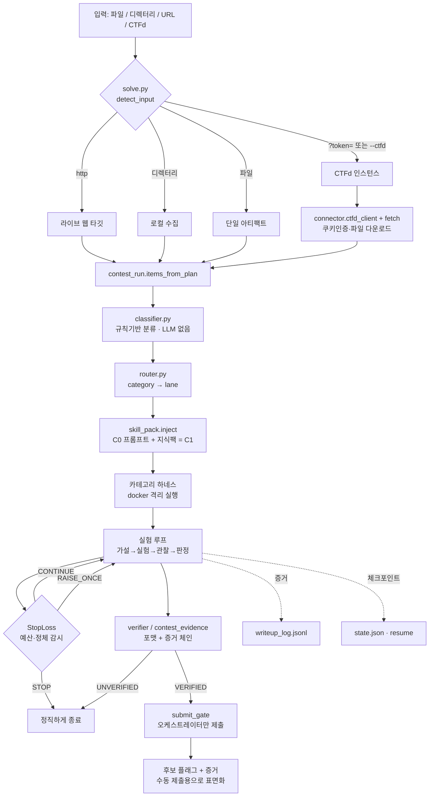
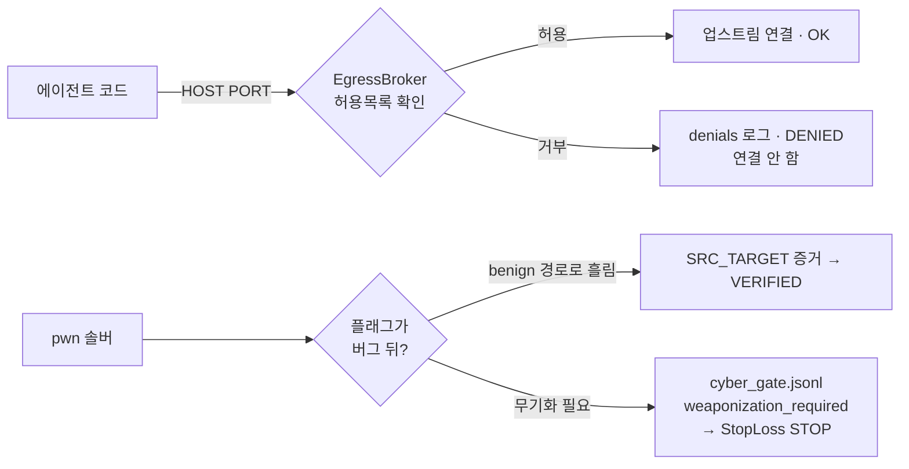
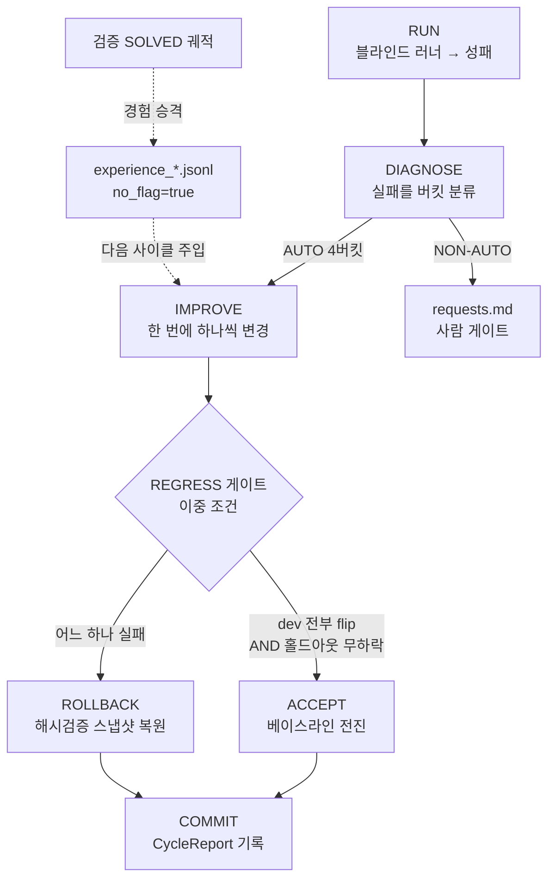

# ARCHITECTURE — ctf_agent_v3 총정리

자율 CTF 풀이 에이전트가 **어떻게 돌아가는지**, 전체 구조·사용 도구·스킬·검증·자가개선을
한눈에 보도록 정리한 문서입니다. (측정 결과는 [RESULTS.md](RESULTS.md), 운영 규칙은
[CLAUDE.md](CLAUDE.md), 카테고리/정책 설계는 [docs/](docs/).)

## 목차
1. [한눈에 보기](#1-한눈에-보기)
2. [두 개의 엔진](#2-두-개의-엔진-중요)
3. [전체 데이터 흐름](#3-전체-데이터-흐름)
4. [두 가지 모드: contest vs bench](#4-두-가지-모드-contest-vs-bench)
5. [디렉터리 지도](#5-디렉터리-지도)
6. [카테고리 → 레인 → 하네스 → 기술](#6-카테고리--레인--하네스--기술)
7. [실행·격리 계층 (샌드박스)](#7-실행격리-계층-샌드박스)
8. [Docker 하네스 이미지](#8-docker-하네스-이미지)
9. [스킬 (지식 팩)](#9-스킬-지식-팩)
10. [검증 & 증거 규율](#10-검증--증거-규율)
11. [`[cyber]` 안전 게이트](#11-cyber-안전-게이트)
12. [제출 게이트 (CTFd)](#12-제출-게이트-ctfd)
13. [Growth 자가개선 루프](#13-growth-자가개선-루프)
14. [거버넌스 (해시 고정 7파일)](#14-거버넌스-해시-고정-7파일)
15. [데이터 스키마](#15-데이터-스키마)

---

## 1. 한눈에 보기

하나의 관리형 진입점 `solve.py`가 입력을 자동 판별(CTFd / URL / 디렉터리 / 파일)하고 모드를
정한 뒤, **트리아지·라우팅 → 카테고리 하네스 → 스킬팩 주입 → StopLoss → 증거기반 검증 →
체크포인트·resume → writeup 로그**를 구동합니다. 핵심 원칙 3가지:

- **격리 우선** — 모든 비신뢰 실행은 docker(`--network none`, read-only, non-root, cap-drop ALL)
  또는 stdlib `unshare` netns + rlimit 안에서만 돈다.
- **증거 기반** — 플래그는 추측·패턴매칭으로 보고하지 않는다. "포맷 매칭 후보 + 실제로
  컨테이너/타깃에서 실행되어 플래그를 출력한 증거"가 **둘 다** 있어야 SOLVED.
- **우회하지 않음** — 익스플로잇 무기화·허용목록 밖 네트워크는 `logged_not_bypassed`로
  기록하고 정직하게 멈춘다(`[cyber]` 게이트).

---

## 2. 두 개의 엔진 (중요)

저장소에는 **서로 다른 2개의 실행 엔진**이 있습니다. 혼동하면 안 됩니다.

| 엔진 | 파일 | 용도 | 특징 |
|---|---|---|---|
| **Phase-0 Supervisor** | `orchestrator/supervisor.py` | 바이트 안정 테스트용 **목업 상태기계** | 단일 큐 FSM, `MockSolver`, LLM·도구 없음, `config/settings.json` 사용. 의도적으로 **동결** |
| **CM Contest 파이프라인** | `orchestrator/contest_run.py` → `rotation.py` (+ `competition.py`) | **실제 라이브/목업 에이전트** | `solve.py --run`이 여기로 디스패치. 스킬팩·StopLoss·EgressBroker·증거검증 전부 연결 |

둘 다 `state.json`을 쓰지만 서로 다른 코드 경로입니다. 아래 설명의 "실제 동작"은 모두
**CM Contest 파이프라인** 기준입니다.

---

## 3. 전체 데이터 흐름



흐름 요약: **스킬(지식) → 하네스가 컨테이너에서 증거 생성 → 검증기가 채점 →
VERIFIED + 증거만 제출게이트 통과 → 오케스트레이터만 제출.** 무기화와 허용목록 밖 egress는
두 개의 `[cyber]` 게이트로 차단·기록됩니다.

---

## 4. 두 가지 모드: contest vs bench

`orchestrator/mode.py`가 단일 소스입니다.

| | **contest (기본)** | **bench (`--bench` 전용)** |
|---|---|---|
| 용도 | 실제 대회 | 블라인드 정직측정 |
| 네트워크 | 챌린지 타깃만 (EgressBroker 경유) | `--network none` |
| 검증 | 서버 또는 플래그포맷 + 증거 | 봉인 볼트 + 스코어러 키 |
| 자동제출 | **안 함** (수동 표면화) | 안 함 |
| 경험 태그 | `contest` | `bench` |
| 목표 | 예산 내 최대 solve | 정직한 성능 측정 |

freeform "풀어줘"는 **contest**를 씁니다. bench는 명시적 요청에서만 진입하며, 거버넌스
동결 파일로 측정 무결성을 보장합니다(§14).

---

## 5. 디렉터리 지도

```
solve.py                  진입점: 입력 자동판별 → 모드 → 플랜 → (--run) 실행
orchestrator/             두뇌
  ├─ mode.py              contest/bench 프로파일 (단일 소스)
  ├─ contest_run.py       CM 파이프라인: items_from_plan → ContestPipeline → RotationRunner
  ├─ rotation.py          멀티 챌린지 시분할·반독점(anti-monopoly) 스케줄
  ├─ competition.py       목업 통합 실행(connector→classify→schedule→StopLoss→submit)
  ├─ classifier.py        확장자·키워드 → category (규칙기반)
  ├─ router.py            category → lane
  ├─ skill_pack.py        지식팩 주입기 (해시 고정 거버넌스)
  ├─ stoploss.py          per-challenge 예산·정체 → CONTINUE/RAISE_ONCE/STOP
  ├─ scheduler.py         flags-per-hour 우선순위
  ├─ triage.py            decoy/obvious-first 스크리닝
  ├─ contest_solvers.py   카테고리 솔버 디스패치 + [cyber] 무기화 게이트
  └─ contest_files.py     파일 아티팩트 트리아지
solver/                   손발 (하네스 + 검증)
  ├─ *_harness.py         rev/crypto/pwn/web/misc/mlsec/ai 카테고리 하네스
  ├─ session.py           스테이트풀 튜브(+EgressBroker, pwntools 없이도 동작)
  ├─ verifier.py          bench SOLVED 규칙 (스코어러 키의 유일 독자)
  ├─ contest_evidence.py  contest SOLVED 규칙 (키 없음, 포맷+증거)
  ├─ experiment_log.py    events/commands.jsonl + dedup 캐시
  └─ web_client.py        루프백 HTTP 튜브
tools/                    공용 실행 계층
  ├─ sandbox.py           격리 백엔드(netns/rlimit/docker) + 상태 분류
  ├─ run_tool.py          run_tool(spec): 검증→격리→실행→결과 스키마
  ├─ web_service.py       web 2-uid 경계 (해시 고정)
  ├─ pwn_service.py       pwn 2-uid 플래그 경계 (해시 고정)
  └─ contest_net.py       EgressPolicy + EgressBroker ([cyber] egress 게이트)
connector/                CTFd I/O
  ├─ ctfd_client.py       stdlib urllib, 쿠키인증, list/get/download/submit
  ├─ fetch.py             챌린지·첨부 다운로드 → arena/live
  └─ submit_gate.py       제출 단일 관문 (해시 고정)
skills/                   카테고리별 마크다운 지식팩 (crypto/misc/pwn/reverse/web)
growth/                   자가개선 루프 (diagnose→improve→regress-gate→commit/rollback)
eval/                     측정 하네스: 러너·스코어러·로더 (정답 생성기/키는 권한잠금)
docker/                   카테고리별 하네스 이미지 Dockerfile
config/                   settings/tools/sandbox.json (+ acdc.env 시크릿·gitignore)
schemas/records.py        Hypothesis/Experiment/Candidate/Checkpoint 데이터클래스
docs/                     STATUS·runbook·정책·findings·카테고리 설계 문서
```

---

## 6. 카테고리 → 레인 → 하네스 → 기술

`classifier.py`는 **LLM 없이** 확장자(+2점)·키워드(+1점)로 category를 정합니다.
카테고리: `crypto · pwn · web · rev · forensics · ai`(기본 `misc`).

| category | lane | 하네스 | 기본 이미지 | 핵심 기술 |
|---|---|---|---|---|
| **rev** | rev_lane | `RevHarness` | `ctfagent-rev:0.1`→`0.2` | **angr 심볼릭 실행** (플래그 출력 도달상태 탐색) + objdump/gdb/strings |
| **crypto** | crypto_lane | `CryptoHarness` | `ctfagent-crypto:0.1`→`0.2` | **sympy 소인수분해**(교과서 RSA), sage/fpylll(격자) |
| **pwn(로컬)** | pwn_lane | `PwnHarness` / `PwnServiceHarness` | `ctfagent-pwn:0.1`→`0.3` | pwntools 튜브, **2-uid 서비스 경계**로 flag.txt 보호 |
| **web** | web_lane | `WebServiceHarness` | `ctfagent-web:0.1`→`0.3` | **2-uid 서비스 경계** + 루프백 HTTP, sqlmap/ffuf/playwright |
| **forensics/misc** | forensics/generic | `MiscHarness` | `ctfagent-misc:0.1`→`0.7` | binwalk/exiftool/steghide/volatility3/john/tesseract 등 |
| **ai** | ai_lane | `MlsecHarness` / `ai_harness` | `ctfagent-mlsec:0.1` | 적대적 ML(FGSM/PGD)·가드바이패스, 신뢰 스코어러가 채점 |

> 모든 하네스는 `CryptoHarness`를 상속해 동일 API(`run_experiment/record_hypothesis/
> report_candidate/check_budget`)와 로그 규약(events/commands/experiments/candidates.jsonl)을
> 공유합니다. 실험 1회 = 컨테이너에서 `python3 -I /work/<name>.py` 한 번, 챌린지 파일은
> `/input`에 읽기전용 마운트.

---

## 7. 실행·격리 계층 (샌드박스)

`tools/run_tool.py`의 `run_tool(spec)` = **검증 → 격리 → 실행 → 결과 스키마**.
비신뢰 코드(`trust:"untrusted"`)는 **docker 백엔드에서만** 허용됩니다.

**격리 백엔드** (`tools/sandbox.py`):

| 프로파일 | 수단 | 네트워크 보장 |
|---|---|---|
| `netns` | `unshare --user --map-root-user --net` | ✅ |
| `rlimit` | rlimit + 경로 jail만 | ❌ (신뢰 유틸 전용) |
| `container` | docker `--network none --read-only --cap-drop ALL --security-opt no-new-privileges --user <uid>` | ✅ |

**강제되는 자원 상한**(child `preexec`): `RLIMIT_CPU`(soft==hard, SIGXCPU로 종료) ·
`RLIMIT_AS`(메모리) · `RLIMIT_FSIZE`(출력파일) · 월타임 타임아웃(`killpg`) · 셸 미경유(argv 리스트).

**실행 상태** 4값 `ok | error | timeout | aborted`로 분류하고, 네트워크 보장 불가 호스트에서는
`network_guaranteed=False`로 **정직하게 표시**합니다. 결과 스키마: `tool_id, execution_status,
return_code, stdout_ref, stderr_ref, duration, resource_usage, reproducibility_level
(full|conditional|external_dependent), sandbox_profile, network_guaranteed, created_files[]`.

**dedup 캐시 키** = `sha256(tool, version(이미지태그), argv, 입력파일 sha256들, env, timeout, cwd)`.
`ok` + 결정론적 실험만 캐시하고, pwn/web(ASLR 등 비결정론)은 캐시하지 않습니다.
캐시 hit는 시도 예산을 소비하지 않습니다.

**핵심 불변식**: `python3 -I`(워킹디렉터리를 `sys.path`에서 제외 → 심어진 `os.py` 하이재킹 차단),
플래그·스코어러 키는 컨테이너에 **절대 마운트하지 않음**(`/input`은 공개 챌린지 파일만).
비밀 플래그는 uid 경계(pwn/web) 또는 신뢰 스코어러(mlsec) 뒤에 두어 **버그를 통해서만** 도달.

---

## 8. Docker 하네스 이미지

이미지는 레이어로 쌓이고(FROM 체인), 빌드타임에만 네트워크를 쓰며 **런타임은 항상
`--network none`** 입니다.

| 카테고리 | 이미지 태그 | 대표 라이브러리 |
|---|---|---|
| crypto | `ctfagent-crypto:0.1` → `0.2` | pycryptodome, gmpy2, sympy, z3 → + sagemath, fpylll, RsaCtfTool |
| rev | `ctfagent-rev:0.1` → `0.2` | binutils/gdb/gcc → + **angr 10.0.5**, z3 |
| pwn | `ctfagent-pwn:0.1` → `0.3` | **pwntools 4.14**, one_gadget, ROPgadget → + pwndbg → + angr, ropper |
| web | `ctfagent-web:0.1` → `0.3` | requests/httpx/bs4, **sqlmap** → + php/flask → + ffuf, playwright+chromium |
| misc | `ctfagent-misc:0.1` → `0.7` | binwalk/exiftool/steghide/foremost/tshark → sleuthkit/john/**volatility3**/hashcat → tesseract/opencv/stegseek+rockyou → pycryptodome → vol3 심볼 캐시 |
| mlsec | `ctfagent-mlsec:0.1` | torch(CPU), onnx, onnxruntime, sklearn |

---

## 9. 스킬 (지식 팩)

"스킬"은 **코드가 아니라 마크다운 플레이북**입니다. 각 카테고리 디렉터리에 라우터 1개
(`SKILL.md`) + 세부 기법 `.md` 여러 개. 라우터는 *관찰된 신호 → 버그/공격 클래스 → 어느 세부
파일 + 어느 도구*로 안내합니다. **완성된 익스플로잇은 없고 지식만** 담깁니다(자기 말로 서술,
특정 챌린지 언급 없음).

| 카테고리 | 파일 | 예시 기법 |
|---|---|---|
| **crypto** | `rsa, ecc_dlog, lattice, prng, sym` | Fermat(가까운 소수), Håstad 브로드캐스트, Wiener/Boneh–Durfee |
| **misc** | `archive, crack, disk, encoding, jail, memory, pcap, qr_barcode, stego` | 메모리 포렌식, pcap 카빙, python jail 탈출 |
| **pwn** | `heap, leaks, rop, glibc_versions` | 힙 익스, 정보 누출, ROP, glibc 버전 함정표 |
| **reverse** | `antidebug, cfg_flatten, constraints, stripped, vm` | 안티디버그 우회, CFG 평탄화, 제약해결(angr/z3), 스트립 분류, VM/바이트코드 |
| **web** | `sqli, ssti, lfi, ssrf_xxe, proto_pollution, tokens_deser, xss_headless, fuzzing` | SQLi(sqlmap), SSTI, JWT/역직렬화, SSRF/XXE, 프로토타입 오염, 헤드리스 XSS |

**주입 메커니즘**(`orchestrator/skill_pack.py`): C0(지식 없는 기본) 프롬프트 뒤에 해당 카테고리
팩을 **덧붙여** C1 프롬프트를 만듭니다. 주입 헤더는 "추측 금지·컨테이너 실행으로 검증" 규칙을
재천명해 C1도 C0와 같은 no-guess 규율을 유지합니다. 팩이 없으면 C0로 자연 degrade.
Growth 루프가 검증된 경험을 `skills/<cat>/experience*.md`로 렌더해 다음 사이클에 주입합니다.

---

## 10. 검증 & 증거 규율

**SOLVED는 두 다리(leg)가 모두 있어야 성립**합니다.

- **bench** (`solver/verifier.py` — 스코어러 키의 유일 독자):
  (a) `candidates.jsonl`의 후보 `value`가 기대 플래그와 일치 **AND**
  (b) `sandbox_profile=="container"`이고 실제로 **실행(ok/error/timeout)되어 stdout에 플래그를
  출력한** 실험이 존재. (a)만 있으면 `FLAG_WITHOUT_SOLUTION`(=UNVERIFIED).
- **contest** (`solver/contest_evidence.py` — 키 없음):
  (a) 플래그가 선언된 `flag_format`에 맞고 **AND** (b) 캡처된 증거 텍스트에 플래그 문자열이 등장.
  증거 소스 = `SRC_TARGET`(서버 응답) 또는 `SRC_EXEC`(컨테이너 stdout). 로컬에서만 판정하므로
  **자동제출 경로가 없습니다**.

둘 다 동일 규율: **추측·패턴매칭·테마추론으로 플래그를 보고하지 않는다.** 실패는 실패로
기록합니다(§RESULTS의 P53 홀드아웃 UNVERIFIED 사례).

---

## 11. `[cyber]` 안전 게이트

두 지점에서 "기록하되 우회하지 않음(`logged_not_bypassed`)"을 구현합니다.



- **Egress 게이트** (`tools/contest_net.py`): per-run (host,port) 허용목록, 기본 deny.
  허용 외 연결은 `denials`에 적고 `DENIED` 반환 후 **다이얼하지 않음**. `session.py`의 브로커
  핸드셰이크가 이 프로토콜을 쓰며, `OK`가 아니면 `BrokerRefused`.
- **무기화 게이트** (`orchestrator/contest_solvers.py`): pwn 솔버는 **비무기화 상호작용만**
  수행(배너 수신 + 양성 newline 한 번). 익스플로잇 **개발이 필요한 지점은 만들지 않고**
  `cyber_gate.jsonl`에 `weaponization_required`/`egress_denied`로 기록 → StopLoss가 정직하게
  STOP. 서비스가 자발적으로 흘린 포맷일치 플래그만 grounded VERIFIED.

---

## 12. 제출 게이트 (CTFd)

`connector/submit_gate.py` = 플래그 제출의 **단일 관문**. 아키텍처 규칙: *서브에이전트는 후보를
보고만 하고, 오케스트레이터만 제출한다.*

- `for_subagent()`는 **클라이언트가 없어 물리적으로 네트워크 불가** → 제출 시 `NotAuthorized`.
- `submit_candidate()` 강제 순서: (a) 역할==orchestrator → (b) `status=="VERIFIED"` + 비어있지
  않은 `evidence_refs` → (c) 중복/이미 solve 아님 → (d) 챌린지당 채점시도 상한.
- 로그 `store/live/submissions.jsonl`는 플래그가 아니라 **sha256만** 기록(스크럽 세이프).
  크래시/재시작 시 로그에서 상태를 재구성해 **중복제출·상한 손실 없음**.
- **자동제출 경로 없음** — `CLAUDE.md` 규칙대로 후보+증거를 사용자에게 표면화해 수동 제출.

CTFd 접속(`connector/ctfd_client.py`)은 stdlib urllib만 사용하고, **세션 쿠키 인증**(ACDC 2026은
`Authorization: Token`을 거부) + Origin/Referer(동일출처 강제) + 401 자동 재로그인 + 429 백오프.

---

## 13. Growth 자가개선 루프

한 사이클 = **run → diagnose → improve → regress-gate → commit/rollback**
(`growth/loop.py`). 루프는 순수 오케스트레이터 — 솔버/러너를 구현하지 않고, 스코어러 키도
읽지 않습니다(전부 의존성 주입).



- **경험 캡처**(`experience.py`): 검증된 non-FWS 궤적만 기법 지문으로 거리화해
  `store/experience_*.jsonl`에 승격(기법은 **에이전트 자신의 트랜스크립트**에서 추출,
  플래그/키는 절대 기록 안 함 `no_flag=true`).
- **진단**(`diagnoser.py`): **fail-safe 비대칭** — 자기수정 가능한 건 AUTO 4버킷뿐
  (`knowledge_gap/experience_gap/budget/approach`). 나머지(tool_gap/harness_bug/fws 등)는
  사람 게이트. 예산소진이라도 **정체/루프면 `approach`**로 분류("예산 늘려도 안 됨"). FWS는
  성공 메모리로 승격 불가.
- **개선**(`improver.py`): 변경을 **하나씩** 적용, 각자 게이트 통과 시 커밋, 실패 시 원자적
  롤백. 변경 전 디스크 스냅샷 + 원장 → 크래시 resume 가능.
- **회귀 게이트**(`regress.py`): **이중조건** — (a) 타깃 실패 cid가 전부 SOLVED로 flip
  **그리고** (b) 블라인드 홀드아웃 점수가 **하락하지 않음**. 홀드아웃 *상승*은 LLM 노이즈일 수
  있어 채택 근거로 쓰지 않음. 어떤 strict 하락도 → 롤백.
- **contest growth**(`contest_growth.py`): contest 학습은 `store/contest/*`에만 기록 →
  블라인드 bench 측정과 **증명 가능하게 격리**(한 테스트가 바이트 동일성 단언).

---

## 14. 거버넌스 (해시 고정 7파일)

`growth/governance_baseline.txt`에 **7개 파일의 sha256이 고정**되어 있고, 자가개선 루프의
`Surface`는 이들을 **절대 수정하지 않습니다**. `sha256sum -c growth/governance_baseline.txt`가
통과해야 합니다.

| 고정 파일 | 지키는 불변식 |
|---|---|
| `orchestrator/skill_pack.py` | 지식 주입이 과다주입/누출로 전복되지 않음 |
| `connector/submit_gate.py` | 제출 단일관문 (역할/증거/중복/상한) |
| `solver/verifier.py` | SOLVED 증거 규칙 |
| `tools/web_service.py` | web 격리 경계 |
| `tools/pwn_service.py` | pwn 2-uid 플래그 경계 |
| `tools/sandbox.py` | 컨테이너 샌드박스(`--network none`, read-only, non-root, rlimit) |
| `config/sandbox.json` | 샌드박스 프로파일 설정 |

이 동결로 self-improvement는 스킬·경험·예산만 튜닝할 수 있고 **측정 하네스 자체는 약화시킬 수
없습니다**. contest 모드가 bench 측정을 오염시킬 수 없는 근본 보장입니다.

---

## 15. 데이터 스키마

`schemas/records.py` — 전부 데이터클래스, `to_dict/from_dict` JSON 왕복, `__post_init__` 검증.

- **Hypothesis**: `id, challenge_id, statement, rationale, refutation_condition,
  priority_band{high,mid,low}, status{proposed,testing,supported,refuted,held}, experiment_ids[]`
- **Experiment**: `id, hypothesis_id, tool, argv[], env, cwd, timeout, dedup_key,
  execution_status{ok,error,timeout,aborted}, observation_ref, hypothesis_judgment
  {support,refute,inconclusive,deferred}, evidence_refs[], nondeterministic`
- **Candidate**: `value, confidence, evidence_refs[], status{UNVERIFIED,VERIFIED,REJECTED}`
- **Checkpoint**: `run_id, challenge_id, active_hypotheses[], budget_spent{time_s,rounds,attempts},
  next_action{kind:dispatch|experiment|done, ...cursor}, safe_point{label,event_seq,command_seq}`

> 핵심 규율: 실험 결과는 `execution_status`(실행이 됐나)와 `hypothesis_judgment`(가설 지지/반박)를
> **분리**합니다. 실행이 `ok`가 아니면 판정을 강제로 `inconclusive`(aborted면 `deferred`)로 바꿔,
> **도구 실패가 가설 반박으로 오역되지 않게** 합니다.

---

*이 문서는 코드 레벨 조사(오케스트레이션·실행계층·스킬/검증·growth) 종합본입니다. 세부 file:line은
각 모듈과 [docs/](docs/)를 참고하세요.*
